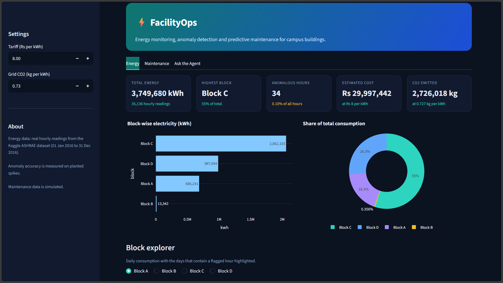
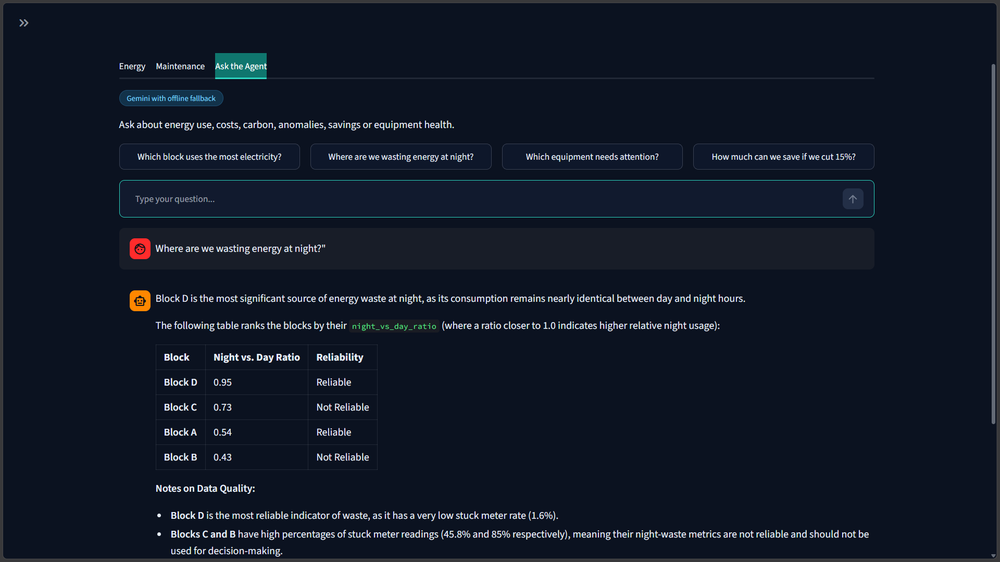
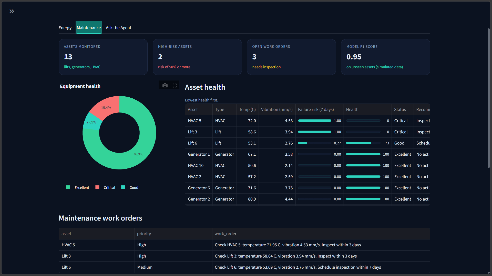

# Agentic FacilityOps AI Platform

**AI-Powered Smart Facility Operations and Optimization**

An AI-powered facility management platform developed as part of the **Infosys Springboard Virtual Internship – Agentic AI for Smart Facility Operations and Optimization**.

The platform combines energy intelligence, machine learning, predictive maintenance and AI-powered assistance to improve facility operations and support data-driven decisions.

## Project Overview

The project focuses on two major areas:

- **Milestone 1 – Energy Intelligence & Monitoring:** Electricity consumption monitoring, anomaly detection, demand forecasting, energy analytics and an AI-powered Energy Agent.
- **Milestone 2 – Predictive Maintenance:** Machine learning-based Remaining Useful Life (RUL) prediction, equipment health assessment, failure-risk analysis and maintenance scheduling.

## System Architecture

```text
          DATA SOURCES
               |
        Data Processing
               |
       +-------+-------+
       |               |
  ENERGY MODULE   MAINTENANCE MODULE
       |               |
  Energy Analytics  Sensor Analysis
       |               |
  Anomaly Detection  ML Prediction
       |               |
  Demand Forecast   Health Scoring
       |               |
       |            Risk Assessment
       |               |
       |          Maintenance Scheduler
       |               |
       +-------+-------+
               |
          AI AGENT
               |
       Decision Support
               |
       Streamlit Dashboard
```

## Milestone 1 – Energy Intelligence & Monitoring

The first milestone focuses on monitoring electricity consumption across four campus buildings represented as Block A, Block B, Block C and Block D.

### Features

- Historical electricity consumption analysis.
- Data-quality checks for stuck meter readings.
- Anomaly detection using Isolation Forest and seasonal baseline analysis.
- Hourly and daily consumption analysis.
- Seven-day electricity demand forecasting.
- Estimated electricity cost and carbon emissions.
- Energy efficiency recommendations.
- Interactive Streamlit dashboard.
- Gemini-powered Energy Agent with offline fallback.

### Energy Dashboard



### Energy Agent



The Energy Agent supports natural-language questions about energy consumption, comparisons between buildings, abnormal usage, savings estimates and demand forecasts.

## Milestone 2 – Predictive Maintenance

The second milestone extends the platform with machine learning-based predictive maintenance.

The implementation uses the NASA C-MAPSS FD001 dataset for engine degradation analysis and Remaining Useful Life prediction.

### 1. Dataset Exploration and Preprocessing

- NASA C-MAPSS training and testing data.
- Sensor data exploration.
- Useful sensor feature selection.
- Remaining Useful Life target preparation.

Implementation: `src/explore_cmapss.py`

### 2. Machine Learning Model

- Random Forest-based predictive modelling.
- Sensor feature processing.
- Model training and prediction.
- Remaining Useful Life estimation.

Implementation: `src/train_model.py`

### 3. Equipment Health Scoring

- Equipment health assessment.
- Health score calculation.
- Equipment condition classification.

Implementation: `src/health_scoring.py`

### 4. Predictive Maintenance Scheduling

- Identification of critical equipment.
- Maintenance priority classification.
- Maintenance recommendations.
- Recommended maintenance schedules.

Implementation: `src/maintenance_scheduler.py`

### 5. Maintenance Intelligence Agent

A maintenance-focused agent provides equipment-related information and supports questions about equipment health, failure risk and maintenance recommendations.

Implementation: `src/maintenance_agent.py`

### Maintenance Dashboard



### Predictive Maintenance Workflow

```text
NASA C-MAPSS Dataset
         |
 Data Exploration
         |
 Data Preprocessing
         |
 Sensor Feature Selection
         |
 Random Forest Training
         |
 RUL Prediction
         |
 Health Scoring
         |
 Risk Assessment
         |
 Maintenance Scheduling
         |
 Maintenance Recommendations
```

## Technologies Used

| Category | Technologies |
|---|---|
| Programming | Python 3.13 |
| Data Processing | Pandas, NumPy |
| Machine Learning | Scikit-learn |
| Algorithms | Random Forest, Isolation Forest |
| Dashboard | Streamlit |
| Visualization | Plotly |
| AI Integration | Google Gemini API |
| Offline Agent | Rule-based Python agent |
| Energy Dataset | Kaggle ASHRAE |
| Maintenance Dataset | NASA C-MAPSS |
| Development Tools | VS Code, Git, GitHub |

## Project Structure

```text
Infosys-facilityops/
│
├── app.py
├── agent.py
├── anomaly.py
├── gemini_agent.py
├── llm_agent.py
├── offline_agent.py
├── maintenance.py
├── prep_kaggle.py
├── fake_ashrae.py
├── test_gemini.py
├── requirements.txt
├── README.md
│
├── .streamlit/
│   └── config.toml
│
├── data/
│   └── Energy dataset files (download separately)
│
├── maintenance_data/
│   ├── train_FD001.txt
│   ├── test_FD001.txt
│   └── RUL_FD001.txt
│
├── models/
│   ├── cmapss_predictions.csv
│   ├── engine_health_scores.csv
│   └── maintenance_schedule.csv
│
├── Screenshots/
│   ├── energy.png
│   ├── maintenance.png
│   └── Agent.png
│
└── src/
    ├── explore_cmapss.py
    ├── train_model.py
    ├── health_scoring.py
    ├── maintenance_scheduler.py
    └── maintenance_agent.py
```

*The trained `.joblib` model and local credentials are excluded from GitHub.*

## Installation and Execution

### 1. Clone the Repository

```bash
git clone https://github.com/srimathy-R04/Infosys-facilityops.git
cd Infosys-facilityops
```

### 2. Install Dependencies

```bash
py -m pip install -r requirements.txt
```

### 3. Prepare Energy Dataset

Download the ASHRAE Great Energy Predictor III dataset from Kaggle and place the required files inside the `data/` folder.

Run:

```bash
py prep_kaggle.py
```

### 4. Run Energy Anomaly Detection

```bash
py anomaly.py
```

### 5. Explore NASA C-MAPSS Dataset

```bash
py src/explore_cmapss.py
```

### 6. Train Predictive Maintenance Model

```bash
py src/train_model.py
```

### 7. Generate Health Scores

```bash
py src/health_scoring.py
```

### 8. Generate Maintenance Schedule

```bash
py src/maintenance_scheduler.py
```

### 9. Launch Dashboard

```bash
py -m streamlit run app.py
```

*The trained model is generated locally and is not included in the GitHub repository. Run the training workflow before executing dependent maintenance modules.*

## AI Agent Capabilities

The platform includes an AI-assisted interaction layer.

**Energy Agent**
- Energy consumption analysis.
- Building comparisons.
- Cost and carbon analysis.
- Anomaly explanations.
- Demand forecasting.
- Energy-saving recommendations.

**Maintenance Agent**
- Equipment health information